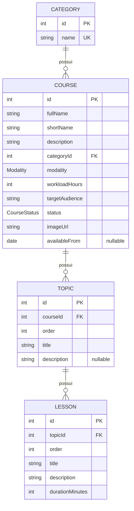
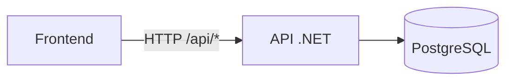

# Courses API

API REST em C#/.NET 10 para listagem, busca e filtro de cursos (dados fictícios), com PostgreSQL e Entity Framework Core.

## Stack

- .NET 10 / ASP.NET Core (Controllers)
- Entity Framework Core + Npgsql (PostgreSQL 17)
- Scalar (documentação interativa da API)
- Docker Compose (banco de dados)

## Como rodar

```bash
# 1. subir o banco
docker compose up -d

# 2. rodar a API (aplica as migrations e popula os dados ao iniciar, em Development)
dotnet run
```

- Documentação: `http://localhost:5116/scalar/v1`
- Health check: `http://localhost:5116/health`

A porta aparece no terminal ao iniciar (ou em `Properties/launchSettings.json`).

## Endpoints

| Método | Rota | Descrição |
|---|---|---|
| GET | `/api/courses` | Lista cursos, com busca, filtros e paginação |
| GET | `/api/courses/{id}` | Detalhes de um curso (com tópicos e aulas) |
| GET | `/api/courses/filters` | Opções disponíveis para os filtros |

### Parâmetros de `GET /api/courses`

| Parâmetro | Tipo | Descrição |
|---|---|---|
| `search` | string | Busca pelo nome completo ou breve |
| `categoryId` | int | Filtra por categoria |
| `modality` | `Online` \| `InPerson` | Filtra por modalidade |
| `status` | `Open` \| `ComingSoon` \| `Finished` | Filtra por status |
| `page` | int (≥ 1) | Página (padrão: 1) |
| `pageSize` | int (1 a 50) | Itens por página (padrão: 12) |

Todos os parâmetros podem ser combinados. A resposta traz `total` (quantidade de resultados da busca), `page`, `pageSize`, `totalPages` e `items`. Sem resultados, retorna `200` com `items: []`.

## Estrutura do projeto

```
├── Modules/
│   └── Courses/          # modelos, DTOs, serviço, controller e seed do módulo
├── Shared/
│   └── Data/             # AppDbContext
├── Migrations/
├── docker-compose.yml
└── Program.cs
```

## CORS

Adicione os domínios permitidos via variáveis de ambiente:

```
Cors__AllowedOrigins__0=https://meusite.com
Cors__AllowedOrigins__1=https://www.meusite.com
```

## Diagrama ER



| Modality | CourseStatus |
|---|---|
| `Online` | `Open` |
| `InPerson` | `ComingSoon` |
| | `Finished` |

## Infraestrutura (Docker Compose)



## Fluxo da listagem com filtros

