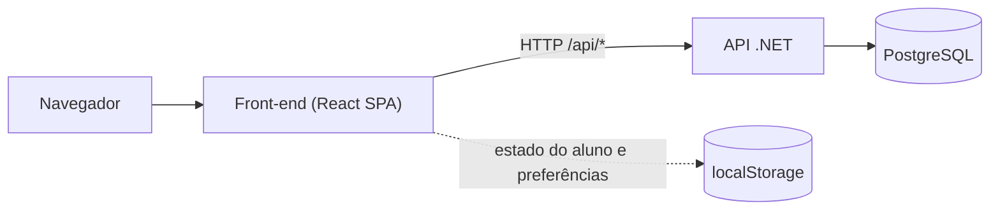
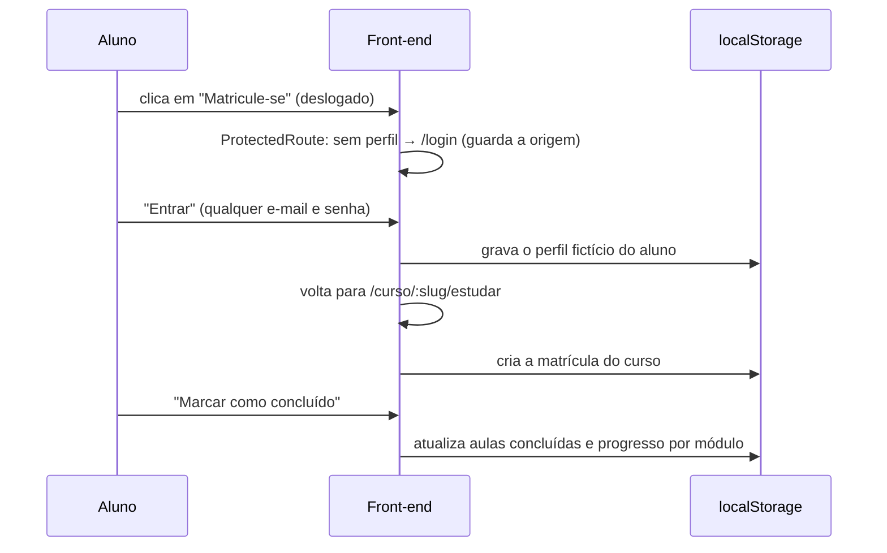
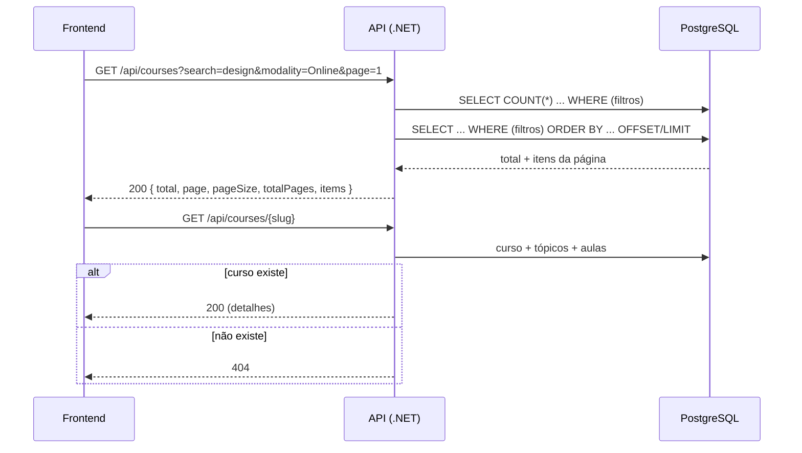
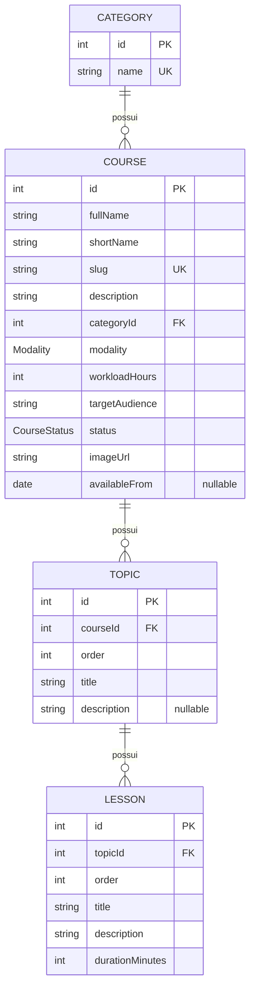
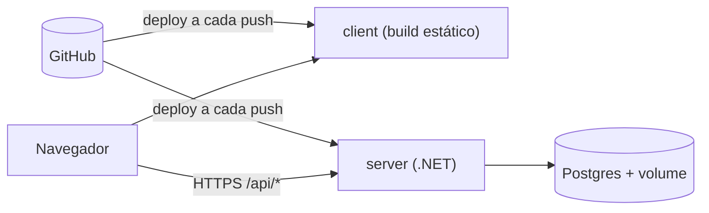

# SESI Indústria — Plataforma de Cursos

Aplicação web de cursos online do SESI Indústria: **front-end em React** e **API REST em .NET 10** com PostgreSQL.

> **Uso de inteligência artificial:** veja [USO_DE_IA.md](USO_DE_IA.md).

> URLS
> - **Front-end:** https://client-production-4d57.up.railway.app
> - **API:** https://server-production-49c8.up.railway.app/health

## Sumário

1. [Objetivo da aplicação](#1-objetivo-da-aplicação)
2. [Tecnologias utilizadas](#2-tecnologias-utilizadas)
3. [Arquitetura da solução](#3-arquitetura-da-solução)
4. [Estrutura das pastas](#4-estrutura-das-pastas)
5. [Instruções para execução](#5-instruções-para-execução)
6. [Configuração do banco](#6-configuração-do-banco)
7. [Endpoints](#7-endpoints)
8. [Modelo de dados](#8-modelo-de-dados)
9. [Estratégia de responsividade](#9-estratégia-de-responsividade)
10. [Decisões de acessibilidade](#10-decisões-de-acessibilidade)
11. [Processo de publicação](#11-processo-de-publicação)
12. [Limitações conhecidas](#12-limitações-conhecidas)

---

## 1. Objetivo da aplicação

Oferecer ao trabalhador da indústria uma plataforma para **descobrir, estudar e acompanhar cursos online**:

- **Vitrine pública:** home, listagem de cursos com busca, filtros e rolagem infinita, página de detalhes do curso e página institucional.
- **Estudo:** ambiente de aula (simulação de um SCORM) com módulos, aulas liberadas em sequência e progresso.
- **Área do aluno:** cursos em andamento e concluídos, certificados e perfil.
- **Acessibilidade:** painel de ajustes (fonte, espaçamento, daltonismo, contraste, animações, régua de leitura) e integração com o VLibras.

A API fornece o catálogo (cursos, categorias, módulos e aulas). Autenticação, matrícula e progresso são **simulados no front-end** (ver [Limitações](#12-limitações-conhecidas)).

## 2. Tecnologias utilizadas

**Front-end** (`client/`)

| Tecnologia              | Uso                                                                   |
| ----------------------- | --------------------------------------------------------------------- |
| React 19 + TypeScript 6 | Interface, com tipagem dos contratos da API                           |
| Vite 8                  | Servidor de desenvolvimento e build                                   |
| React Router 7          | Rotas (SPA), rotas protegidas                                         |
| TanStack Query 5        | Requisições, cache, estados de carregamento/erro e paginação infinita |
| SCSS Modules (Sass)     | Estilos isolados por componente, com tokens e mixins em `_theme.scss` |
| Swiper 11               | Carrosséis                                                            |
| Lucide React            | Ícones                                                                |
| ESLint 10               | Qualidade de código (inclui regras do React Hooks)                    |
| Yarn                    | Gerenciador de pacotes                                                |

**Back-end** (`server/`)

- .NET 10 / ASP.NET Core (Controllers)
- Entity Framework Core + Npgsql (PostgreSQL 17)
- Scalar (documentação interativa da API) / OpenAPI
- Docker Compose (banco de dados)

**Serviços de terceiros:** VLibras (tradução para Libras, gov.br), YouTube (vídeo institucional, via `youtube-nocookie.com`) e Cloudinary (hospedagem das imagens dos cursos).

## 3. Arquitetura da solução

SPA (Single Page Application) que consome uma API REST. O front não acessa o banco; a API é o único ponto de acesso aos dados do catálogo.



### Back-end — monólito modular em camadas

```
Controller  →  Service (interface)  →  AppDbContext (EF Core)  →  PostgreSQL
 (HTTP)         (regras e consultas)      (mapeamento)
```

- **Módulos** (`Modules/Courses`): cada módulo agrupa modelos, DTOs, serviço, controller e configuração de entidades. O serviço é registrado por `AddCoursesModule()`.
- **DTOs imutáveis (`record`)** isolam o contrato da API do modelo do banco; as consultas projetam direto para DTO (`Select`) e usam `AsNoTracking`.
- **Enums como texto** (`Online`, `Open`...) no JSON e no banco.
- **`GET /api/courses/filters`** devolve as opções de filtro, para o front não ter valores fixos no código.
- **Migrations aplicadas ao iniciar**, com seed de cursos de exemplo.

### Front-end — organização por responsabilidade

```
pages  →  components  →  hooks  →  services / data
(rotas)   (UI reutilizável) (lógica)  (API, localStorage, conteúdo estático)
```

- **Estado do servidor** (cursos): TanStack Query, com `queryKey` por recurso (`["courses", slug]`, `["courses", "list", filtros]`, `["popularCourses"]`).
- **Estado do cliente** (aluno e acessibilidade): `localStorage` lido por `useSyncExternalStore`, para a interface reagir a mudanças inclusive entre abas.
- **Estado na URL:** busca e filtros (`/cursos?search=...`), aula atual (`?aula=bancos-relacionais`) e aba da área do aluno (`?aba=...`). Assim os links são compartilháveis e o botão "voltar" funciona.
- **Componentes de UI** usam elementos nativos estilizados (`<dialog>`, `<progress>`, `<select>`, radios, checkbox) em vez de reconstruí-los.
- **Rotas**

| Rota                   | Página                                  | Acesso  |
| ---------------------- | --------------------------------------- | ------- |
| `/`                    | Home                                    | Público |
| `/cursos`              | Listagem com filtros e rolagem infinita | Público |
| `/curso/:slug`         | Detalhes do curso                       | Público |
| `/sobre`               | Institucional                           | Público |
| `/login`               | Login simulado                          | Público |
| `/curso/:slug/estudar` | Ambiente de estudo                      | Logado  |
| `/area-do-aluno`       | Área do aluno (abas)                    | Logado  |
| `*`                    | Página não encontrada                   | Público |

### Fluxo de login e matrícula (simulado)



## 4. Estrutura das pastas

```
.
├── client/                       # Front-end (React + Vite)
│   ├── index.html
│   ├── vite.config.ts
│   ├── package.json
│   └── src/
│       ├── assets/               # fontes, ícones e imagens
│       ├── components/           # um diretório por componente (.tsx + .module.scss)
│       │   ├── Accessibility/    # painel de acessibilidade (botão, store, filtros, régua)
│       │   ├── Header/ Footer/ Container/ SectionHeading/ ...
│       │   ├── Button/ Input/ Select/ Textarea/ Tabs/ Drawer/ ...   # base de UI
│       │   ├── CourseCard/ CourseFilters/ CourseHero/ ...           # cursos
│       │   └── CourseMenu/ LessonContent/ StudyLayout/ ...          # ambiente de estudo
│       ├── data/                 # conteúdo estático e mapeamentos (navegação, rodapé, categorias, currículo das aulas)
│       ├── hooks/                # useAuth, useCourseStudy, useStudent, useInfiniteScroll, useScrolled
│       ├── pages/                # Home (App.tsx), Courses, CourseDetails, CourseStudy, StudentArea, Login, About, NotFound
│       ├── services/             # courses.ts (API) e studentStorage.ts (localStorage)
│       ├── styles/               # _theme.scss (tokens e mixins) e global.scss
│       ├── App.tsx               # Home
│       └── main.tsx              # providers e rotas
│
└── server/                       # Back-end (.NET 10)
    ├── Program.cs                # configuração, CORS, migrations e seed ao iniciar
    ├── Modules/
    │   └── Courses/              # controller, serviço, DTOs, seed e configurações de entidade
    │       └── Models/           # Category, Course, Topic, Lesson e enums
    ├── Shared/
    │   └── Data/                 # AppDbContext
    ├── Migrations/
    ├── Properties/launchSettings.json
    ├── docker-compose.yml
    └── SesiTeste.http            # requisições de exemplo
```

## 5. Instruções para execução

**Pré-requisitos:** Node.js 22+ e Yarn, .NET 10 SDK, Docker.

```bash
# 1. Banco de dados (PostgreSQL)
cd server
docker compose up -d

# 2. API (aplica as migrations e popula os cursos ao iniciar)
dotnet run

# 3. Front-end (em outro terminal)
cd client
yarn
yarn dev
```

| Serviço                      | URL                                                                                         |
| ---------------------------- | ------------------------------------------------------------------------------------------- |
| Front-end                    | `http://localhost:5173`                                                                     |
| API                          | `http://localhost:5116` (a porta aparece no terminal e em `Properties/launchSettings.json`) |
| Documentação da API (Scalar) | `http://localhost:5116/scalar/v1`                                                           |
| Health check                 | `http://localhost:5116/health`                                                              |

O front lê o endereço da API em `client/.env`:

```
VITE_API_URL=http://localhost:5116
```

**Scripts do front-end**

| Comando        | O que faz                                   |
| -------------- | ------------------------------------------- |
| `yarn dev`     | Servidor de desenvolvimento                 |
| `yarn build`   | Verifica os tipos (`tsc -b`) e gera `dist/` |
| `yarn preview` | Serve o build localmente                    |
| `yarn lint`    | Roda o ESLint                               |

**Acesso à área do aluno:** em `/login` entram **qualquer e-mail e senha** (campos já vêm preenchidos).

## 6. Configuração do banco

- **Imagem:** PostgreSQL 17 pelo `docker-compose.yml`, na porta **5434** do host (para não conflitar com um Postgres local na 5432).
- **Credenciais de desenvolvimento** (`appsettings.Development.json`):

```
Host=localhost;Port=5434;Database=default;Username=postgres;Password=postgres
```

- **Em outros ambientes** (ex.: Railway), informe a conexão por variável de ambiente:

```
ConnectionStrings__Default=Host=...;Port=5432;Database=...;Username=...;Password=...
```

- **Extensão `unaccent`:** a busca ignora acentos usando a extensão `unaccent` do PostgreSQL, criada automaticamente por uma migration. O usuário do banco precisa ter permissão para criar extensões (o usuário padrão do Docker e do Railway tem).
- **Migrations e seed:** ao iniciar, a API executa `MigrateAsync()` (cria o banco e aplica as migrations pendentes) e depois o `CourseSeeder`, que cadastra categorias, cursos, módulos e aulas de exemplo se a tabela de cursos estiver vazia.
- **Recriar os dados de exemplo:** inicie com `Seed__Reset=true` (ou `Seed:Reset` no `appsettings`). Isso executa `TRUNCATE` nas tabelas e popula de novo.
- **Comandos do EF Core** (na pasta `server/`):

```bash
dotnet ef migrations add NomeDaMigration   # nova migration
dotnet ef database update                   # aplica manualmente
```

> **Atenção:** a migration `AddCourseSlug` apaga os cursos existentes (`TRUNCATE`) antes de criar o índice único do slug. Em um banco com dados reais, faça backup antes.

### CORS

Adicione os domínios permitidos via variáveis de ambiente. Em desenvolvimento, `http://localhost:5173` já está liberado.

```
Cors__AllowedOrigins__0=https://client-production-4d57.up.railway.app
Cors__AllowedOrigins__1=https://meusite.com
```

Sem nenhuma origem configurada, nenhum site de outro domínio consegue chamar a API pelo navegador.

## 7. Endpoints

| Método | Rota                   | Descrição                                            |
| ------ | ---------------------- | ---------------------------------------------------- |
| GET    | `/api/courses`         | Lista cursos, com busca, filtros e paginação         |
| GET    | `/api/courses/{slug}`  | Detalhes de um curso pelo slug (com módulos e aulas) |
| GET    | `/api/courses/{id}`    | Detalhes de um curso pelo id numérico                |
| GET    | `/api/courses/filters` | Opções disponíveis para os filtros                   |
| GET    | `/health`              | Verificação de saúde da API                          |

O front-end usa o **slug** (`/curso/algebra-linear-aplicada`). A rota por id numérico continua disponível.

### Parâmetros de `GET /api/courses`

| Parâmetro    | Tipo                                 | Descrição                                                                                                |
| ------------ | ------------------------------------ | -------------------------------------------------------------------------------------------------------- |
| `search`     | string                               | Busca pelo nome completo ou breve (sem diferenciar maiúsculas nem acentos: `algebra` encontra "Álgebra") |
| `categoryId` | int                                  | Filtra por categoria                                                                                     |
| `modality`   | `Online` \| `InPerson`               | Filtra por modalidade                                                                                    |
| `status`     | `Open` \| `ComingSoon` \| `Finished` | Filtra por status                                                                                        |
| `page`       | int (≥ 1)                            | Página (padrão: 1)                                                                                       |
| `pageSize`   | int (1 a 50)                         | Itens por página (padrão: 12)                                                                            |

Todos os parâmetros podem ser combinados. A lista é ordenada por nome do curso. A resposta traz `total` (quantidade de resultados da busca), `page`, `pageSize`, `totalPages` e `items`. Sem resultados, retorna `200` com `items: []`.

### Códigos de resposta

| Código | Quando                                                                    |
| ------ | ------------------------------------------------------------------------- |
| `200`  | Sucesso                                                                   |
| `400`  | Parâmetro inválido (ex.: `pageSize` fora de 1–50, `modality` inexistente) |
| `404`  | Curso não encontrado (por slug ou id)                                     |

### Exemplo — `GET /api/courses?search=algebra&pageSize=1`

```json
{
  "total": 1,
  "page": 1,
  "pageSize": 1,
  "totalPages": 1,
  "items": [
    {
      "id": 1,
      "fullName": "Álgebra Linear Aplicada",
      "shortName": "Álgebra Linear",
      "slug": "algebra-linear-aplicada",
      "description": "Vetores, matrizes, sistemas lineares e autovalores...",
      "category": { "id": 1, "name": "Matemática" },
      "modality": "Online",
      "workloadHours": 60,
      "targetAudience": "Estudantes de exatas e engenharia...",
      "status": "Open",
      "imageUrl": "https://...",
      "availableFrom": null
    }
  ]
}
```

`GET /api/courses/{slug}` devolve os mesmos campos mais `topics` (módulos), cada um com `lessons` (aulas: `id`, `order`, `title`, `description`, `durationMinutes`).

### Fluxo da listagem com filtros



## 8. Modelo de dados

### Banco de dados (PostgreSQL)



| Modality   | CourseStatus                |
| ---------- | --------------------------- |
| `Online`   | `Open` (matrículas abertas) |
| `InPerson` | `ComingSoon` (em breve)     |
|            | `Finished` (encerrado)      |

Regras: `categories.name` e `courses.slug` são únicos; excluir um curso exclui seus módulos e aulas (cascata); uma categoria com cursos não pode ser excluída (restrito). Enums são gravados como texto.

### Dados do aluno (localStorage — apenas no navegador)

| Chave                | Conteúdo                                                                                      |
| -------------------- | --------------------------------------------------------------------------------------------- |
| `sesi:student`       | `profile` (perfil do aluno logado ou `null`) e `enrollments`, indexado pelo **slug** do curso |
| `sesi:accessibility` | Preferências de acessibilidade                                                                |

```ts
// sesi:student
{
  version: 1,
  profile: { name, email, registration, company, jobTitle, city, phone, memberSince } | null,
  enrollments: {
    "algebra-linear-aplicada": {
      slug, title, imageUrl,
      enrolledAt, updatedAt, completedAt,        // ISO; completedAt = null até chegar a 100%
      lastLessonSlug, completedLessonIds: string[],
      progress: {
        percent, completed, total,
        modules: { [moduleId]: { title, completed, total, percent } }
      }
    }
  }
}

// sesi:accessibility
{ fontScale: 100|115|130|150, spacing: "normal"|"medium"|"large",
  colorMode: "none"|"protanopia"|"deuteranopia"|"tritanopia"|"grayscale",
  highContrast, reduceMotion, ruler }
```

Os módulos e aulas do ambiente de estudo são **montados no front** a partir dos módulos da API, mais um módulo fixo de "Introdução" (Introdução, Boas práticas e Extras) que todo curso recebe.

#### Slugs das aulas (decisão)

A URL de estudo usa um identificador legível da aula, como `/curso/sql-modelagem-dados/estudar?aula=bancos-relacionais`, em vez de um id interno (`t67-l199`). O slug **não existe no banco**: é gerado no front, em `data/studyContent.ts`, a partir do título (sem acentos, minúsculo, separado por hífens) e deixado único dentro do curso com sufixo (`-2`, `-3`) quando há títulos repetidos. A aula de introdução de cada módulo usa o título do módulo, e as aulas fixas usam `introducao`, `boas-praticas` e `extras`.

Motivos: o teste não exige alterar o modelo de dados, e as aulas já são combinadas no front com conteúdo fixo, então o slug acompanha esse mesmo ponto de montagem. O **progresso continua gravado pelo id interno** (`completedLessonIds`), que não muda se um título for editado; só o link muda. Um slug inexistente ou de aula ainda bloqueada na URL volta para a aula atual do aluno.

Alternativa não adotada: coluna `slug` em `lessons` com índice único `(topic_id, slug)` ou por curso. É mais robusta (o slug fica estável e vem da API), mas exige migration, seed e DTO novos.

## 9. Estratégia de responsividade

- **Desktop-first** com o mixin `down($breakpoint)` (`max-width`). Breakpoints centralizados em `_theme.scss`:

| Token    | Largura | Uso principal                                                |
| -------- | ------- | ------------------------------------------------------------ |
| `$bp-lg` | 1024px  | Menu do estudo vira Drawer; layouts de duas colunas empilham |
| `$bp-md` | 768px   | Header troca os links pelo menu hambúrguer                   |
| `$bp-sm` | 560px   | Grades de uma coluna, botões e controles quebram linha       |

- **Container** com largura máxima de 1212px e respiro lateral de 24px (`min(100% - 48px, 1212px)`).
- **Grades fluidas:** `grid-template-columns: repeat(auto-fill, minmax(260px, 1fr))` na listagem de cursos, sem depender de breakpoints.
- **Tipografia fluida:** títulos com `clamp()`; todos os `font-size` em **`rem`**, para respeitar a configuração do navegador e o aumento de fonte da acessibilidade.
- **Navegação adaptada:** no Header, os links viram menu hambúrguer + Drawer abaixo de 768px; no ambiente de estudo, o menu lateral fixo vira o mesmo Drawer abaixo de 1024px; as abas da área do aluno rolam na horizontal.
- **Mídia:** imagens com `object-fit: cover`, vídeos com `aspect-ratio: 16 / 9` e `max-width: 100%` nas imagens.
- **Estados de carregamento** com skeletons que mantêm a mesma forma dos cards, evitando saltos de layout.
- **Barra de matrícula fixa** no rodapé do navegador nos detalhes do curso.

## 10. Decisões de acessibilidade

**HTML semântico e elementos nativos**

- Uso de elementos nativos sempre que possível, estilizados em vez de reconstruídos: `<dialog>` (Drawer), `<progress>`, `<select>`, `<fieldset>/<legend>` com radios, `<input type="checkbox" role="switch">`, `<button>` e `<a>`.
- **Drawer** sobre `<dialog>` com `showModal()`: foco preso, `Esc` fecha, `aria-modal` e `aria-labelledby` nativos; o scroll da página é travado enquanto aberto.
- **Abas** no padrão WAI-ARIA (`tablist`/`tab`/`tabpanel`), com setas, `Home` e `End` e _roving tabindex_.
- **Acordeões** com `aria-expanded` e `aria-controls`.
- Idioma da página declarado como `pt-BR`.

**Teclado e foco**

- Anel de foco visível e consistente (`:focus-visible`) em todos os controles, via mixin `focus-ring`.
- Botões desabilitados usam o atributo `disabled` (e não só estilo).
- Navegação no ambiente de estudo por links reais (`aria-current="page"` na aula atual).

**Informação além da cor**

- O status das aulas (concluída, disponível, bloqueada) é indicado por **ícone e texto** para leitores de tela, não só por cor.
- Barras de progresso têm `aria-label` e o percentual em texto.

**Leitores de tela**

- Imagens decorativas com `alt=""`; ícones com `aria-hidden`.
- Estados de carregamento com `role="status"` ("Carregando curso…") e `aria-busy`.
- Botão de vídeo com nome descritivo; o `iframe` do YouTube só é carregado ao clicar e recebe `title`.

**Painel de acessibilidade** (botão flutuante à direita, persistido no `localStorage`)

- Tamanho do texto de 100% a 150%.
- Espaçamento entre linhas, letras e palavras (padrão, médio, grande).
- Daltonismo: protanopia, deuteranopia e tritanopia (filtros de correção) e escala de cinza.
- Alto contraste (realce de contraste e links sublinhados).
- Pausar animações; já vem ligado se o sistema operacional pedir `prefers-reduced-motion`.
- Régua de leitura que acompanha o mouse e o foco do teclado.
- "Restaurar padrões".

**Libras:** integração com o **VLibras** (widget do governo federal).

## 11. Processo de publicação

A aplicação está publicada no **[Railway](https://railway.com)**, em um único projeto com **três serviços**.

| Parte          | Serviço no Railway                                 | URL                                            |
| -------------- | -------------------------------------------------- | ---------------------------------------------- |
| Front-end      | `client` (repositório GitHub, diretório `client/`) | https://client-production-4d57.up.railway.app/ |
| API            | `server` (repositório GitHub, diretório `server/`) | _(preencher)_                                  |
| Banco de dados | `Postgres` (com volume `postgres-volume`)          | Rede interna do projeto (sem acesso público)   |



A publicação segue **esta ordem**: banco → API → front-end.

### 1. Banco de dados

Crie o serviço **Postgres** no projeto. O **volume** (`postgres-volume`) mantém os dados entre reinicializações e novos deploys.

### 2. API (`server`)

Crie um serviço a partir do repositório GitHub, com o diretório raiz em `server/`. O Railway compila o projeto .NET a cada push.

Variáveis de ambiente do serviço:

| Variável                     | Valor                                                 |
| ---------------------------- | ----------------------------------------------------- |
| `ASPNETCORE_ENVIRONMENT`     | `Production`                                          |
| `ConnectionStrings__Default` | String de conexão do Postgres do projeto (ver abaixo) |
| `Cors__AllowedOrigins__0`    | `https://client-production-4d57.up.railway.app`       |

O Railway expõe os dados do banco em variáveis do serviço Postgres. Monte a string no formato do Npgsql referenciando-as:

```
ConnectionStrings__Default=Host=${{Postgres.PGHOST}};Port=${{Postgres.PGPORT}};Database=${{Postgres.PGDATABASE}};Username=${{Postgres.PGUSER}};Password=${{Postgres.PGPASSWORD}}
```

As migrations e o seed rodam sozinhos na primeira inicialização. Gere um domínio público para o serviço e confirme que `/health` responde `200`.

> A documentação interativa (Scalar/OpenAPI) só é exposta em `Development`; em produção as rotas `/scalar` e `/openapi` não existem.

### 3. Front-end (`client`)

Crie um serviço a partir do repositório GitHub, com o diretório raiz em `client/`, e defina a variável abaixo **antes do build**. Ela é lida em tempo de build (`import.meta.env`), então alterá-la exige um novo deploy:

| Variável       | Valor                           |
| -------------- | ------------------------------- |
| `VITE_API_URL` | URL pública do serviço `server` |

O build (`yarn build`) gera `dist/`, servido como site estático.

**Importante — fallback de SPA:** como o app usa `BrowserRouter`, o servidor precisa devolver `index.html` para qualquer rota (por exemplo, `/curso/algebra-linear-aplicada` ou `/area-do-aluno` não podem dar 404 ao recarregar a página).

### Atualizações

Cada `push` na branch configurada dispara um novo deploy do serviço correspondente. Alterações no banco entram por **migrations**, aplicadas na inicialização da API.

### Checklist pós-publicação

- [ ] `GET {API}/health` responde `200`.
- [ ] A listagem de cursos carrega no front (sem erro de CORS no console do navegador).
- [ ] Recarregar uma rota interna (ex.: `/cursos`, `/area-do-aluno`) não retorna 404.
- [ ] O login simulado, a matrícula e o ambiente de estudo funcionam.

## 12. Limitações conhecidas

### Itens não concluídos

- **Integração com o Moodle:** não realizada (o escopo a trata como diferencial opcional). O catálogo é servido por API própria, sem conexão com um ambiente Moodle.
- **Cadastro, edição e exclusão de cursos:** não desenvolvidos (o escopo dispensa); o catálogo vem do seed.
- **Autenticação no back-end:** não implementada; existe apenas a simulação no front-end (detalhes abaixo).

### Limitações

**Autenticação e dados do aluno**

- **Não há autenticação no back-end** (o escopo do teste não a exige). O login é **simulado no front-end**: qualquer e-mail e senha entram, e o perfil do aluno é fictício e fixo. Não há token, sessão, cadastro ou recuperação de senha.
- **Matrícula, progresso e certificados ficam no `localStorage`**: são perdidos ao limpar os dados do navegador, não sincronizam entre dispositivos e podem ser alterados pelo usuário nas ferramentas de desenvolvedor. Por isso, **a liberação sequencial das aulas é apenas visual/local**, não uma regra de segurança.
- Os botões "Certificado" e "Baixar certificado" são ilustrativos (não geram arquivo).
- Não há endpoints de escrita (cadastro/edição de cursos) nem painel administrativo; o catálogo vem do seed.

**Ambiente de estudo**

- O "SCORM" é uma **simulação**: não implementa o padrão SCORM (sem API de LMS, sem rastreamento padronizado).
- O texto das aulas é **gerado no front** a partir do título, da descrição e da duração; não há vídeos, materiais ou avaliações por aula. O conteúdo da "Introdução", "Boas práticas" e "Extras" é genérico.

**Catálogo e API**

- "Cursos populares" do rodapé são os primeiros cursos da listagem em ordem alfabética: **não existe métrica de popularidade**.
- A busca considera só o nome completo e o breve (não a descrição). Ela ignora maiúsculas e acentos, mas não tolera erros de digitação.
- Paginação por `OFFSET/LIMIT`: simples, mas pode ficar lenta com muitos registros e, na rolagem infinita, itens podem repetir ou faltar se o catálogo mudar durante a navegação.
- Sem cache HTTP, limite de requisições (_rate limiting_) ou versionamento da API.
- Todos os cursos usam a mesma imagem de capa; não há upload de imagens.
- As migrations e o seed rodam a cada inicialização; em produção, o ideal é controlá-las por um passo de implantação.

**Conteúdo estático**

- Depoimentos, estatísticas, FAQ e textos institucionais são fixos no código.
- Vários links são placeholders (`#`): redes sociais, Termos de Uso, Política de Privacidade, Blog, Central de Ajuda, etc.
- Os formulários de contato são apenas visuais (não enviam dados).
- Interface somente em português (sem internacionalização) e sem modo escuro.

**Acessibilidade e responsividade**

- Os filtros de daltonismo são **aproximações** e não substituem o cuidado de não depender só de cor; o alto contraste usa filtro de imagem, não um tema próprio.
- O aumento de fonte vai até 150%; ícones e alguns elementos de altura fixa (como a barra do Header) não escalam junto.
- A régua de leitura é pensada para mouse/teclado.
- O VLibras e o vídeo do YouTube dependem de serviços externos e de conexão; sem eles, não aparecem.
- Não há _skip link_ ("pular para o conteúdo"), e a conformidade com a WCAG não foi auditada com ferramentas automáticas nem com leitores de tela reais.
- Os testes visuais foram feitos principalmente em Chromium (viewports de celular e desktop); não houve validação em Safari, Firefox e dispositivos físicos.

**Qualidade e operação**

- Não há testes automatizados (front-end ou back-end); a validação foi manual.
- Não há pipeline de CI/CD próprio (o deploy é disparado pelo Railway a cada push, sem etapa de testes) nem `Dockerfile` para a API (o Docker Compose atende só o banco local).
- SPA sem renderização no servidor: as tags de SEO são estáticas e não há `sitemap`.

## 13. Diferenças entre o Figma e a implementação

**Páginas Sobre e Área do Aluno + Login (fictício)**

- O Figma não mostra as páginas Sobre e Área do Aluno;
- Foi implementadas seguindo o mesmo estilo visual e a mesma tipografia do Figma;
- O login é fictício, qualquer e-mail e senha entram, e o perfil do aluno é fixo.

**Página de detalhes do curso**

- Foi adicionado um texto sobre o público-alvo do curso, que não estava no Figma;
- Foram adicionados a carga horária do curso e a modalidade do mesmo;
- Essas informações estão disponíveis na API, mas não estavam no Figma.

**Página do AVA**

- Menu lateral: tem diferenças que favorecem a responsividade e acessibilida, além de facilitar o uso pelo usuário;
- Área de Conteúdo: foi alterado para usar o máximo possível do espaço disponível, e para que o conteúdo seja mais legível;
- Botão de Conclusão: foi adicionado um botão para marcar a aula como concluída, que não estava no Figma.

**Página Sobre**

- Foram adicionadas informações sobre a instituição, que não estavam no Figma;
  -Foi adicionado um formulário de contato totalmente simulado, que não envia dados para lugar nenhum, mas que segue o mesmo estilo visual do restante da página;
